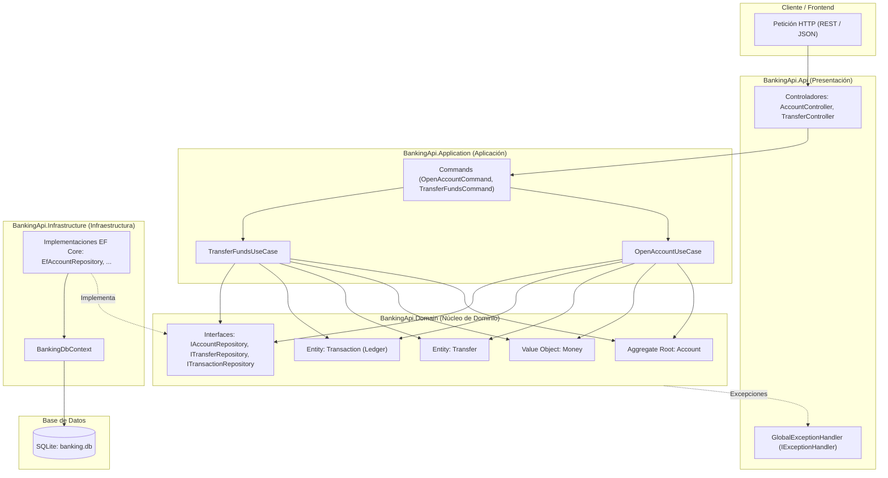

# Banking API - Clean Architecture & DDD en .NET 10

API bancaria de alto rendimiento para apertura de cuentas y transferencias monetarias seguras entre cuentas, diseñada siguiendo los principios de **Domain-Driven Design (DDD)**, **Clean Architecture**, **Idempotencia estricta**, **Libro Mayor de Partida Doble (Double-Entry Ledger)** y **Control de Concurrencia Optimista (OCC)**.

---

## 📌 Tabla de Contenidos
1. [Descripción](#-descripción)
2. [Arquitectura y Diagramas](#-arquitectura-y-diagramas)
3. [Tecnologías Utilizadas](#-tecnologías-utilizadas)
4. [Estructura del Proyecto](#-estructura-del-proyecto)
5. [Requisitos Previos](#-requisitos-previos)
6. [Cómo Ejecutar el Proyecto](#-cómo-ejecutar-el-proyecto)
7. [Cómo Correr Migraciones](#-cómo-correr-migraciones)
8. [Cómo Ejecutar los Tests](#-cómo-ejecutar-los-tests)
9. [Documentación de Endpoints](#-documentación-de-endpoints)
10. [Reglas y Casos de Negocio](#-reglas-y-casos-de-negocio)

---

## 📖 Descripción

Esta solución implementa un núcleo bancario transaccional desacoplado y preparado para entornos concurrentes. Sus características principales son:
- **Modelo de Dominio Rico**: La lógica de negocio reside exclusivamente en el dominio, protegiendo invariantes como saldos no negativos y transiciones de estado válidas.
- **Auditoría e Inmutabilidad**: Cada movimiento financiero genera registros de débito y crédito en un libro mayor (*ledger*) inmutable.
- **Idempotencia Robusta**: Garantiza que reintentos de transferencias con la misma clave de idempotencia no dupliquen movimientos de dinero.
- **Concurrencia Optimista**: Protege los saldos frente a condiciones de carrera mediante tokens de concurrencia (`Version`).
- **Manejo Global de Errores**: Centralizado mediante `IExceptionHandler`, sin bloques `try/catch` dispersos en los controladores.

---

## 🏛 Arquitectura y Diagramas

El proyecto sigue rigurosamente la regla de dependencia de **Clean Architecture**: las capas internas no conocen detalles de las capas externas.

### Diagrama de Capas Conceptual

```text
       ┌────────────────────────────────────────────────────────┐
       │                     BankingApi.Api                     │
       │     (Controllers, IExceptionHandler, Program.cs)       │
       └───────────────────────────┬────────────────────────────┘
                                   │
                                   ▼
       ┌────────────────────────────────────────────────────────┐
       │                 BankingApi.Application                 │
       │             (Use Cases, Commands, DTOs)                │
       └───────────────────────────┬────────────────────────────┘
                                   │
                                   ▼
       ┌────────────────────────────────────────────────────────┐
       │                   BankingApi.Domain                    │
       │       (Aggregates, Value Objects, Repositories)        │
       └───────────────────────────▲────────────────────────────┘
                                   │  (Inversión de Dependencias)
       ┌───────────────────────────┴────────────────────────────┐
       │                BankingApi.Infrastructure               │
       │         (EF Core, DbContext, Migrations, Repos)        │
       └───────────────────────────┬────────────────────────────┘
                                   │
                                   ▼
       ┌────────────────────────────────────────────────────────┐
       │                     SQLite Database                    │
       │                      (banking.db)                      │
       └────────────────────────────────────────────────────────┘
```

### Diagrama de Flujo de Componentes (Mermaid)



---

## 🛠 Tecnologías Utilizadas

- **Plataforma**: [.NET 10 SDK](https://dotnet.microsoft.com/) (C#)
- **Framework Web**: ASP.NET Core Web API
- **ORM**: Entity Framework Core 10.0
- **Base de Datos**: SQLite (mediante `Microsoft.EntityFrameworkCore.Sqlite`)
- **Documentación de API**: Swagger / OpenAPI (`Swashbuckle.AspNetCore`)
- **Testing**:
  - `xUnit 2.9.3`
  - `Moq 4.20.72`
  - `Microsoft.AspNetCore.Mvc.Testing 10.0.5` (TestServer en memoria)
  - `Coverlet` (cobertura de código)

---

## 📁 Estructura del Proyecto

```text
├── BankingApi.slnx                         # Archivo de solución .NET
├── README.md                               # Documentación principal
│
├── BankingApi.Domain/                      # Capa de Dominio (Cero dependencias externas)
│   ├── Exceptions/                         # DomainException
│   ├── Models/                             # Account, Money, Transfer, Transaction
│   └── Repositories/                       # IAccountRepository, ITransferRepository, ITransactionRepository
│
├── BankingApi.Application/                 # Capa de Aplicación
│   ├── Commands/                           # OpenAccountCommand, TransferFundsCommand
│   └── UseCases/                           # OpenAccountUseCase, TransferFundsUseCase
│
├── BankingApi.Infrastructure/              # Capa de Infraestructura
│   ├── Migrations/                         # Migraciones de EF Core
│   ├── Persistence/                        # BankingDbContext, Configuraciones Fluent API
│   └── Repositories/                       # EfAccountRepository, EfTransferRepository, EfTransactionRepository
│
├── BankingApi.Api/                         # Capa de Presentación (API)
│   ├── Controllers/                        # AccountController, TransferController
│   ├── Middlewares/                        # GlobalExceptionHandler (IExceptionHandler)
│   ├── Properties/                         # launchSettings.json
│   ├── appsettings.json                    # Configuración de Logging y BD
│   └── Program.cs                          # Configuración del pipeline y contenedor DI
│
└── BankingApi.Tests/                       # Suite de Pruebas Automatizadas
    ├── Unit/                               # Pruebas Unitarias de Dominio y Casos de Uso
    ├── Integration/                        # Pruebas de Integración con WebApplicationFactory
    └── Concurrency/                        # Pruebas de Concurrencia y Carrera
```

---

## 📋 Requisitos Previos

1. [.NET 10.0 SDK](https://dotnet.microsoft.com/download) instalado en el equipo.
2. Herramienta de línea de comandos de Entity Framework Core:
   ```powershell
   dotnet tool install --global dotnet-ef
   ```

---

## 🚀 Cómo Ejecutar el Proyecto

1. **Clonar o abrir el repositorio**:
   ```powershell
   cd projectAPILoanPaymentProcessingDotnet
   ```

2. **Compilar la solución**:
   ```powershell
   dotnet build
   ```

3. **Iniciar la API**:
   ```powershell
   dotnet run --project BankingApi.Api
   ```

4. **Acceder a la documentación Swagger**:
   - HTTP: [http://localhost:5284/swagger](http://localhost:5284/swagger)
   - HTTPS: [https://localhost:7107/swagger](https://localhost:7107/swagger)

---

## 🗄 Cómo Correr Migraciones

Las migraciones gestionan el esquema de la base de datos SQLite local (`banking.db`).

### Crear una nueva migración:
```powershell
dotnet ef migrations add <NombreDeMigracion> --project BankingApi.Infrastructure --startup-project BankingApi.Api
```

### Aplicar migraciones a la base de datos:
```powershell
dotnet ef database update --project BankingApi.Infrastructure --startup-project BankingApi.Api
```

### Eliminar la última migración (si aún no se aplicó):
```powershell
dotnet ef migrations remove --project BankingApi.Infrastructure --startup-project BankingApi.Api
```

---

## 🧪 Cómo Ejecutar los Tests

La suite incluye **39 pruebas automatizadas** que cubren pruebas unitarias, de integración y escenarios de alta concurrencia.

### Ejecutar todas las pruebas:
```powershell
dotnet test BankingApi.Tests\BankingApi.Tests.csproj
```

### Ejecutar únicamente Tests Unitarios:
```powershell
dotnet test BankingApi.Tests\BankingApi.Tests.csproj --filter "FullyQualifiedName~Unit"
```

### Ejecutar únicamente Tests de Integración:
```powershell
dotnet test BankingApi.Tests\BankingApi.Tests.csproj --filter "FullyQualifiedName~Integration"
```

### Ejecutar únicamente Tests de Concurrencia:
```powershell
dotnet test BankingApi.Tests\BankingApi.Tests.csproj --filter "FullyQualifiedName~Concurrency"
```

---

## 📡 Documentación de Endpoints

### 1. Apertura de Cuenta

Crea una nueva cuenta bancaria para un cliente con un depósito inicial opcional.

- **Método**: `POST`
- **Ruta**: `/accounts`
- **Cabeceras**: `Content-Type: application/json`

#### Payload de Entrada:
```json
{
  "customerId": "3fa85f64-5717-4562-b3fc-2c963f66afa6",
  "initialDeposit": 1000.00
}
```

#### Respuestas:
- **`201 Created`**: Cuenta abierta satisfactoriamente.
  ```json
  {
    "accountId": "a1b2c3d4-e5f6-7a8b-9c0d-1e2f3a4b5c6d",
    "accountNumber": "ACC-7F2A1BC9",
    "status": "ACTIVE"
  }
  ```
- **`400 Bad Request`**: Depósito inicial negativo o datos inválidos.
  ```json
  {
    "message": "Initial deposit cannot be negative."
  }
  ```

---

### 2. Transferencia de Fondos

Transfiere fondos de una cuenta origen a una cuenta destino de forma idempotente y atómica.

- **Método**: `POST`
- **Ruta**: `/transfers`
- **Cabeceras**: `Content-Type: application/json`

#### Payload de Entrada:
```json
{
  "sourceAccountId": "a1b2c3d4-e5f6-7a8b-9c0d-1e2f3a4b5c6d",
  "targetAccountId": "b2c3d4e5-f6a7-8b9c-0d1e-2f3a4b5c6d7e",
  "amount": 150.00,
  "idempotencyKey": "tx-demo-001"
}
```

#### Respuestas:
- **`200 OK`**: Transferencia aceptada / completada.
  ```json
  {
    "idempotencyKey": "tx-demo-001",
    "status": "ACCEPTED"
  }
  ```
- **`400 Bad Request`**: Datos de entrada inválidos (ej. cuentas vacías o importe $\le 0$).
  ```json
  {
    "message": "Transfer amount must be greater than zero."
  }
  ```
- **`409 Conflict`**: Colisión de concurrencia detectada o duplicidad simultánea en la clave de idempotencia.
  ```json
  {
    "code": "CONCURRENCY_CONFLICT",
    "message": "A concurrency conflict occurred. Please retry the operation."
  }
  ```
- **`422 Unprocessable Entity`**: Error de regla de negocio (ej. fondos insuficientes o cuenta origen inexistente).
  ```json
  {
    "code": "INSUFFICIENT_FUNDS",
    "message": "Not enough balance to perform the operation."
  }
  ```

---

### 3. Consultar Estado de Transferencia

Permite consultar el estado de una transferencia a partir de su clave de idempotencia.

- **Método**: `GET`
- **Ruta**: `/transfers/{idempotencyKey}`

#### Respuestas:
- **`200 OK`**: Transferencia encontrada.
  ```json
  {
    "idempotencyKey": "tx-demo-001",
    "status": "Completed"
  }
  ```
- **`404 Not Found`**: No existe una transferencia asociada a dicha clave.
  ```json
  {
    "message": "Transfer with idempotency key 'tx-demo-001' not found."
  }
  ```

---

## 🧠 Reglas y Casos de Negocio

### 1. Inmutabilidad y Precisión con Value Object `Money`
- Se evita el uso directo de tipos de punto flotante para prevenir discrepancias por redondeo.
- Toda magnitud monetaria se modela con el struct inmutable `Money`, que redondea a 2 decimales usando redondeo bancario (`MidpointRounding.ToEven`).

### 2. Libro Mayor de Partida Doble (*Double-Entry Ledger*)
- El dinero no se crea ni desaparece: cada transferencia debita la cuenta de origen y acredita la cuenta de destino registrando dos entradas inmutables en la tabla `account_transactions`:
  1. `Transaction.Debit`: Descuenta saldo del origen con descripción de destino.
  2. `Transaction.Credit`: Incrementa saldo en destino con descripción de origen.

### 3. Idempotencia Estricta
- Las transferencias exigen un identificador `idempotencyKey`.
- Un índice único a nivel de base de datos (`UNIQUE INDEX`) y una verificación previa en `TransferFundsUseCase` impiden que reintentos de red o clientes dupliquen un débito.

### 4. Control de Concurrencia Optimista (OCC)
- La entidad `Account` contiene la propiedad `Version`, configurada con `.IsConcurrencyToken()` en EF Core.
- Cada modificación al Aggregate (`Credit`, `Debit`, `Close`) incrementa `Version++`.
- Si dos peticiones simultáneas intentan modificar la misma cuenta al mismo tiempo, la segunda falla inmediatamente con `DbUpdateConcurrencyException`, traducida por el middleware a `409 Conflict`, impidiendo condiciones de carrera o sobregiros concurrentes.
